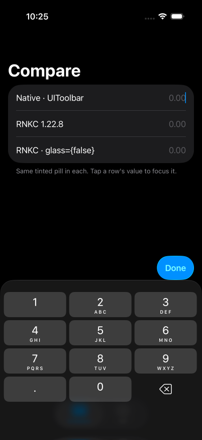
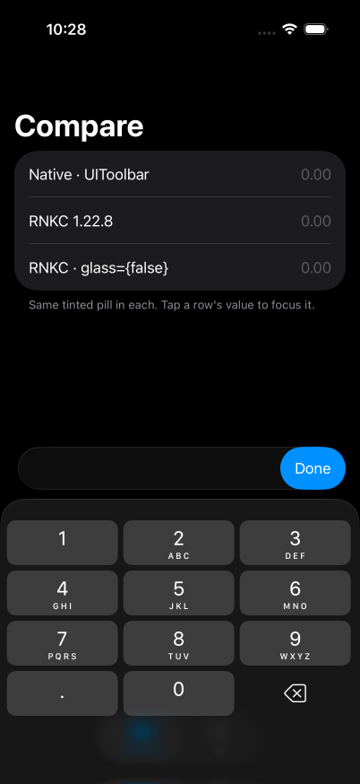
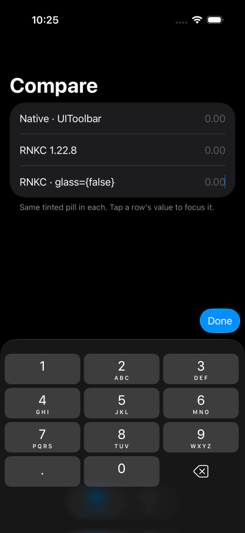

# rnkc-done-glass

On iOS 26, `KeyboardExtender` always wraps its children in a full-width glass capsule. A native
`UIToolbar` accessory with a single button doesn't. It draws just that button as its own floating
glass pill.

| Native `UIToolbar` | RNKC 1.22.8 | RNKC + `glass={false}` |
| --- | --- | --- |
|  |  |  |

- The capsule comes from `ModernContainerView`, so nothing in JS can remove it.
- Proposal: a `glass` prop that defaults to `true` (iOS only). `false` keeps the same frames and
  the same 10pt gap above the keyboard, but skips the glass view.
- Diff against 1.22.8: [`proposal/keyboard-extender-glass-prop.patch`](proposal/keyboard-extender-glass-prop.patch)

## Run

```sh
./build.sh <simulator UDID>   # Xcode 26+, iOS 26+ simulator
```

The RNKC rows use the library's own `KeyboardExtenderContainerView.swift`, unmodified from
1.22.8 (`vendor/`). More: iOS 27 shots and enter/exit recordings are in `media/`.
